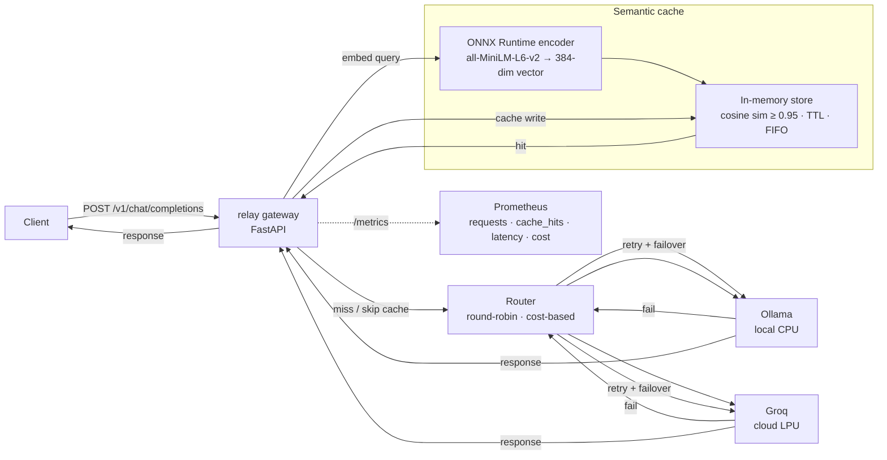

# relay

A self-hostable **LLM inference gateway** with an OpenAI-compatible API. Routes requests across multiple providers (Ollama, Groq), with semantic caching, retry/failover, and Prometheus observability — deployed on Render's free tier using a torch-free ONNX Runtime inference path.

**Live demo:** https://relay-j8s0.onrender.com

> The free-tier instance spins down after 15 min of inactivity. First request after idle takes ~30-60 s to cold-start; subsequent requests are fast.

## Why

Every team using LLMs hits the same problems: vendor lock-in, unpredictable latency, no caching, no visibility into cost. `relay` sits between your application and LLM providers, giving you one stable endpoint with routing, caching, failover, and metrics.

## Features

- **OpenAI-compatible API** — drop-in replacement for `openai.ChatCompletion.create()`
- **Multi-provider routing** — round-robin or cost-based across Ollama (local) and Groq (cloud)
- **Semantic caching** — `all-MiniLM-L6-v2` embeddings + cosine similarity; skip the provider entirely on cache hits
- **Retry & failover** — exponential backoff per provider, automatic fallback to next provider
- **Observability** — Prometheus metrics (p50/p95/p99 latency, cache hit rate, cost saved), structured JSON logging
- **Torch-free deployment** — ONNX Runtime + numpy mean pooling replaces PyTorch in the runtime image, cutting RAM from 500 MB+ to 176 MB and fitting a 512 MB free-tier instance

## Quick start (Docker)

```bash
git clone https://github.com/lwu1822/relay.git
cd relay

# Set your Groq API key
export GROQ_API_KEY=your-key-here

# Start the gateway + reach Ollama on the host via host.docker.internal
docker compose up

# Test (uses Ollama's llama3.2:1b by default in config.docker.yaml)
curl http://localhost:8000/v1/chat/completions \
  -H "Content-Type: application/json" \
  -d '{"model": "llama3.2:1b", "messages": [{"role": "user", "content": "Hello!"}]}'
```

## Quick start (local, no Docker)

```bash
git clone https://github.com/lwu1822/relay.git
cd relay

# Install dev dependencies (includes sentence-transformers + torch for local dev)
pip install -r requirements-dev.txt

# Configure
cp config.example.yaml config.yaml
# edit config.yaml with your provider settings

# Run
uvicorn app.main:app --reload

# Test
curl http://localhost:8000/v1/chat/completions \
  -H "Content-Type: application/json" \
  -d '{"model": "llama3.2:1b", "messages": [{"role": "user", "content": "Hello!"}]}'
```

## Architecture



## Configuration

See [`config.example.yaml`](config.example.yaml) for all options. Key settings:

| Field | Description | Default |
|-------|-------------|---------|
| `providers` | List of provider configs (type, base_url, api_key, model) | — |
| `cache.enabled` | Enable semantic cache | `true` |
| `cache.backend` | Embedding engine: `torch` (local dev) or `onnx` (deploy) | `torch` |
| `cache.model_dir` | Path to ONNX model dir (required when `backend: onnx`) | `null` |
| `cache.similarity_threshold` | Cosine similarity required for a hit | `0.95` |
| `cache.ttl_seconds` | Entry expiry | `3600` |
| `cache.max_size` | In-memory entry cap (FIFO eviction) | `1000` |

## Benchmark

A benchmark script (`scripts/benchmark.py`) fires ~1000 requests at a running
relay instance with a mix of exact-duplicate, near-duplicate (paraphrased),
and unique prompts, then diffs the Prometheus counters at `/metrics` before
and after the run to report cache hit rate, latency percentiles, and
throughput.

### Run it

```bash
# Terminal 1: start the gateway (Ollama must be running on :11434)
uvicorn app.main:app --reload

# Terminal 2: run the benchmark
python scripts/benchmark.py --url http://localhost:8000 --count 1000
```

Flags: `--concurrency` (default 20), `--dup-ratio` (default 0.4),
`--near-dup-ratio` (default 0.3), `--model` (default `llama3.2:1b`).

### Results

| Requests | OK | Throughput (req/s) | Cache hit rate | p50 (ms) | p95 (ms) | p99 (ms) |
|----------|-----|--------------------|----------------|----------|----------|----------|
| 1000 | 1000 | 5.01 | 88.40% | 162.4 | 32919.3 | 35945.6 |

> The benchmark prints a ready-to-paste table row at the end of each run.

**Reading these numbers:** The 1000-request mix was 40% exact-duplicate,
30% near-duplicate (paraphrased), and 30% unique prompts, fired at
concurrency 20 against a single Ollama (`llama3.2:1b`) backend.

- **88.40% cache hit rate** — 884 of 1000 requests were served from the
  semantic cache, skipping the LLM provider entirely. This includes
  near-duplicate paraphrases (e.g. "What is the capital of France?" vs
  "Which city is the capital of France?") matched via cosine similarity
  over `all-MiniLM-L6-v2` embeddings at threshold 0.95.
- **p50 = 162 ms** — the median request is a cache hit; this is the
  embedding encode + similarity scan cost, not LLM inference.
- **p95/p99 = 33–36 s** — the tail is dominated by the ~116 unique
  requests that required a real Ollama call (`llama3.2:1b` on local CPU),
  queued behind concurrency-20 in-flight work. This is a property of the
  local single-process backend, not the gateway; a faster provider
  (e.g. Groq cloud) would compress the tail substantially.

## Deployment

The gateway deploys to [Render](https://render.com)'s free tier (512 MB RAM, no credit card) via a multi-stage Dockerfile:

- **Builder stage** — installs PyTorch + `optimum` to export `all-MiniLM-L6-v2` to ONNX format
- **Runtime stage** — slim image with only `onnxruntime` + `tokenizers` + `numpy` (no torch); 685 MB image, 176 MB RAM at runtime

The same image runs locally (via `docker compose up` with `config.docker.yaml` pointing at host Ollama) and in production (with `config.deploy.yaml` pointing at Groq). Config selection is via the `RELAY_CONFIG_PATH` environment variable; `GROQ_API_KEY` is set in the Render dashboard.

| Metric | With PyTorch | With ONNX Runtime | Change |
|--------|-------------|-------------------|--------|
| Docker image | 2.2 GB | 685 MB | -69% |
| Runtime RAM | 500 MB+ | 176 MB | -65% |
| Embedding accuracy | — | identical (same weights) | 0% |

## Tech stack

- **Python 3.11+** / FastAPI / httpx / pydantic v2
- **ONNX Runtime** + **tokenizers** for torch-free embedding inference (deploy)
- **sentence-transformers** (`all-MiniLM-L6-v2`) for local dev embeddings
- **numpy** for mean pooling (replaces sentence-transformers' Pooling module in deploy)
- **prometheus-client** for metrics
- **structlog** for structured logging
- **Docker** multi-stage build / **Render** deployment

## License

TBD